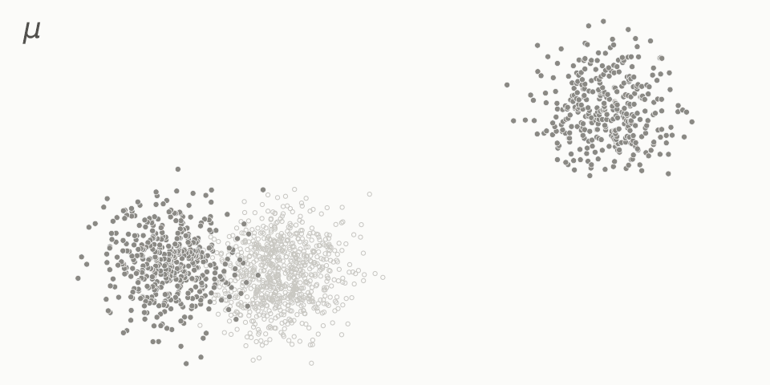

# Minimax Optimal Estimation of Transport-Growth Pairs in Unbalanced Optimal Transport

<picture>
  <source media="(prefers-color-scheme: dark)" srcset="assets/uot-dark.gif">
  
</picture>

This repository provides the code for the paper *Minimax Optimal Estimation of Transport-Growth Pairs in Unbalanced Optimal Transport* (NeurIPS 2026).

## Installation

To install the dependencies, run

```
pip install -r requirements.txt
```

The code was tested with Python 3.14. The SSUOT baseline uses [MOSEK](https://www.mosek.com) when a license is available and [SCS](https://www.cvxgrp.org/scs/) otherwise. The results in the paper were obtained with MOSEK.

## Simulation study

To run the simulation study and plot its results, run

```
python run_simulation.py --out simulation.csv
python plot_simulation.py simulation.csv --out simulation.pdf
```

## Shape completion

To run the shape completion experiment, run

```
python run_shapes.py --out shapes.pdf
```

On its first run, the script downloads the [Completion3D](https://completion3d.stanford.edu) dataset (5.8 GB) into `completion3d/`. Use of the dataset is subject to the [ShapeNet Terms of Use](https://www.shapenet.org/terms).

## Citation

If you use this code, please cite our paper:

```bibtex
@inproceedings{ponnoprat2026minimax,
  title={Minimax Optimal Estimation of Transport-Growth Pairs in Unbalanced Optimal Transport},
  author={Ponnoprat, Donlapark and Isobe, Noboru and Imaizumi, Masaaki},
  booktitle={Advances in Neural Information Processing Systems},
  year={2026}
}
```

If you use the shape completion experiment, please also cite the Completion3D dataset:

```bibtex
@inproceedings{topnet2019,
  title={TopNet: Structural Point Cloud Decoder},
  author={Tchapmi, Lyne P and Kosaraju, Vineet and Rezatofighi, S. Hamid and Reid, Ian and Savarese, Silvio},
  booktitle={The IEEE Conference on Computer Vision and Pattern Recognition (CVPR)},
  year={2019}
}

@inproceedings{yuan2018pcn,
  title={PCN: Point Completion Network},
  author={Yuan, Wentao and Khot, Tejas and Held, David and Mertz, Christoph and Hebert, Martial},
  booktitle={3D Vision (3DV), 2018 International Conference on},
  year={2018}
}

@article{chang2015shapenet,
  title={ShapeNet: An Information-Rich 3D Model Repository},
  author={Chang, Angel X. and Funkhouser, Thomas A. and Guibas, Leonidas J. and Hanrahan, Pat and Huang, Qi-Xing and Li, Zimo and Savarese, Silvio and Savva, Manolis and Song, Shuran and Su, Hao and Xiao, Jianxiong and Yi, Li and Yu, Fisher},
  journal={CoRR},
  volume={abs/1512.03012},
  year={2015}
}
```
